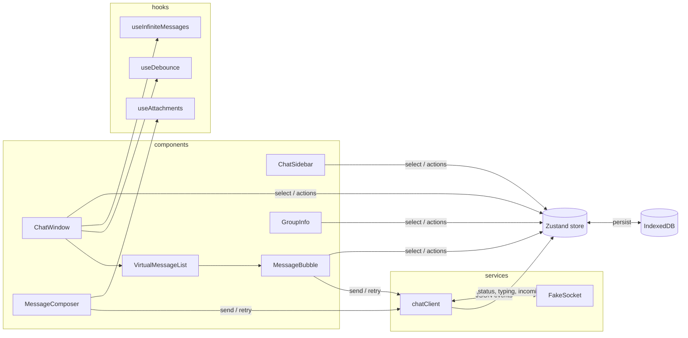

# Pulse Chat

WhatsApp Web–style chat app. React 19 · TypeScript · Vite · Tailwind v4 · Zustand · React Hook Form · Lucide · Jest. No backend.

## Setup

```bash
npm install
npm run dev     # http://localhost:5173
npm test        # Jest + Testing Library
npm run build   # typecheck + production build
```

## Features

**Core** — conversation list (avatars, online dot, last message, time, unread badge), debounced search, All/Unread/Groups filters · send/receive, timestamps, ✓ / ✓✓ / blue ✓✓ ticks, replies, edit, delete, copy, emoji reactions, date separators, typing indicator, auto-scroll when at bottom · group info, member online status, add/remove members · responsive (mobile list ⇄ chat), light/dark, in-chat message search, Enter to send / Shift+Enter newline / Esc cancels reply or search.

**Advanced (all built without extra libraries)**

| Challenge | Where | How |
|---|---|---|
| Virtualized list (10k+) | `shared/utils/virtualization.ts`, `components/VirtualMessageList.tsx` | Prefix-sum offsets over measured row heights; only visible rows + overscan render. Header 🗄 button seeds 10,000 messages. |
| Optimistic sending | `store.sendMessage`, `services/chatClient.ts` | Message shown instantly as `sending`; socket ack → `sent` → `delivered` → `read`. 10% simulated failure → **Retry**. |
| Infinite scroll | `hooks/useInfiniteMessages.ts` | Shows newest 50; scrolling near top loads 50 more (fake latency). Scroll position anchored on prepend. |
| Persistence | `shared/utils/idbStorage.ts` | Zustand `persist` over a hand-written IndexedDB adapter (debounced writes; localStorage fallback). |
| Offline queue | `services/chatClient.ts` | Wi-Fi button in left rail (or real browser offline) → new messages `queued`; flushed in order on reconnect. Queue survives reload. |
| Debounced search | `shared/hooks/useDebounce.ts` | Sidebar (name + message content) and in-chat search. |
| Attachment preview | `hooks/useAttachments.ts` | Local files → `URL.createObjectURL` previews (revoked on cleanup); converted to data URLs on send so they persist (≤ 2 MB each). |
| WebSocket simulation | `services/fakeSocket.ts` | Class with the browser `WebSocket` shape (`readyState`, `send`, `close`, `onopen/onmessage/onclose`) emitting acks, typing and replies. |

## Architecture



```
src/
  App.tsx                 shell: theme + starts realtime after hydration
  features/chat/
    index.ts              public API of the feature (App imports only this)
    components/           ChatSidebar, ChatWindow, VirtualMessageList, MessageBubble, MessageComposer, GroupInfo, Avatar
    hooks/                useInfiniteMessages, useAttachments
    services/             chatClient (business logic) + fakeSocket (transport)
    store/                single Zustand store — domain state and pure actions
    utils/ data/ types/   date rows, mock data, typed models
  shared/                 feature-agnostic: useDebounce, virtualization, idbStorage
```

## Key decisions

- **One Zustand store, pure actions.** Store knows nothing about the network; `chatClient` owns side effects (socket, timers, retries) and writes results back through store actions. UI never touches the socket, so swapping `FakeSocket` for `new WebSocket(url)` touches one file.
- **Message status is the queue.** No separate queue array — `status: 'queued'` is persisted with the message, so the offline queue survives reloads for free. In-flight `sending` messages are re-queued on disconnect/reload.
- **Selectors per field** keep re-renders narrow; `MessageBubble` is memoized.
- **Virtualizer measures after render** (`useLayoutEffect`) and compensates scroll when rows above the viewport change height, so there's no jump when content loads.
- **Pure helpers are unit-tested** (`getVirtualRange`, `buildRows`); behaviour tests cover the store, the socket flow (optimistic → ack, offline flush, retry) and the composer (keyboard + attachment preview).

## Assumptions / trade-offs

- Single local user (`me`); other users and replies are simulated.
- Whole state is persisted as one JSON blob — simple, fine for ~10k messages; a real app would store messages per row in IndexedDB and page from it.
- Attachments are data URLs (size-capped) for persistence simplicity; real app would upload and store a URL.
- Virtual range uses a linear scan (O(n), sub-millisecond at 10k); binary search would be the next step at 100k+.
- Fake send failure (10%) is intentional, to demo the retry path.
